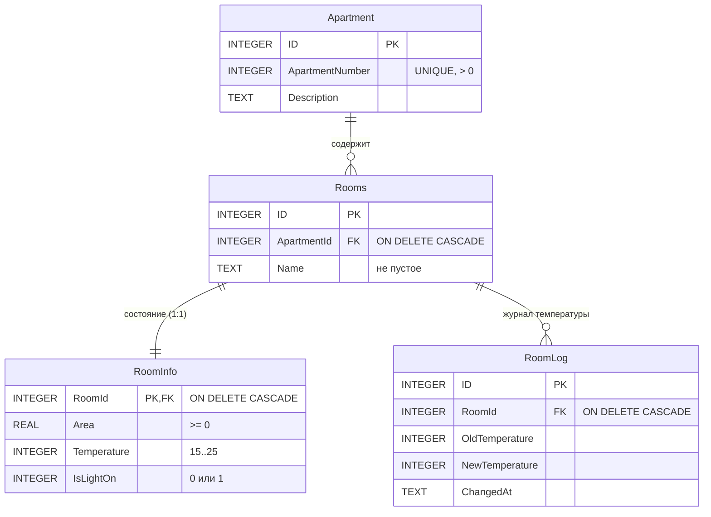

# ER-диаграмма

**Почему `RoomInfo` вынесена отдельно.** В `Rooms` лежат постоянные данные комнаты (к какой квартире относится, как называется),
а в `RoomInfo` — изменяемое состояние (площадь, температура, свет). Это связь «один к одному», при которой
первичный ключ `RoomInfo.RoomId` одновременно является внешним ключом на `Rooms.ID`.

**Объекты базы данных:**

| Объект | Назначение |
|---|---|
| `v_room_details` (VIEW) | «Плоская» таблица комнат с номером квартиры, используется в нескольких запросах |
| `trg_roominfo_temperature_log` (TRIGGER) | При смене температуры добавляет запись в `RoomLog` |
| `idx_rooms_apartment`, `idx_roomlog_room` (INDEX) | Ускоряют выборку комнат квартиры и журнала комнаты |
